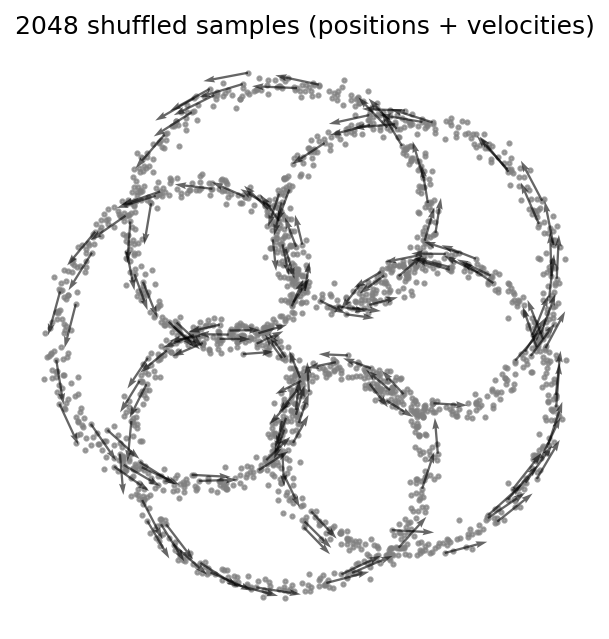
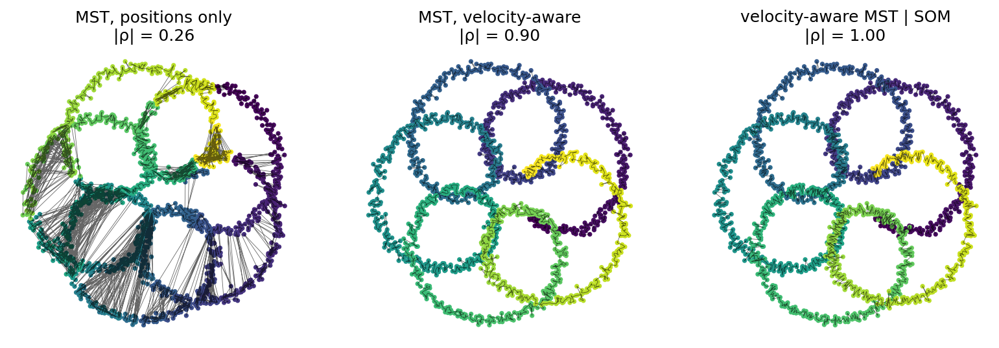
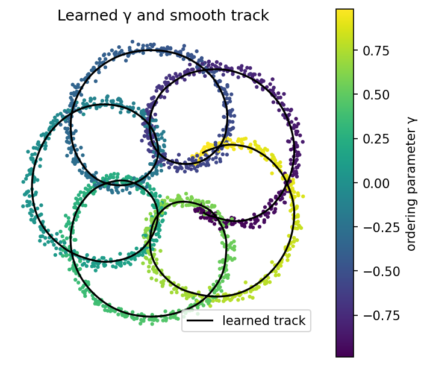

<!--
OUTLINE / DRAFT. Lives on a branch of GalacticDynamics/phasecurvefit until ready.
To move to pyOpenSci/pyopensci.github.io:
  - this file   -> content/blog/2026-MM-DD-phasecurvefit.md (set date/lastmod)
  - blog/images -> static/images/blog/2026/phasecurvefit/
  - change the image paths below from `images/...` to `/images/blog/2026/phasecurvefit/...`
Figures: `uv run --group docs python blog/make_figures.py`
-->

<!-- Hook (2-3 sentences). -->

Lots of data are samples scattered along a curve: stars in a stellar stream,
particles along an orbit, a trajectory seen out of order. Before you can fit a
model you need to know _where along the curve_ each sample sits. `phasecurvefit`
answers that question, and it has recently been
[accepted into the pyOpenSci ecosystem](https://github.com/pyOpenSci/software-submission/issues/285).

## The problem: order is lost

<!--
- Samples come shuffled; you have positions (and often velocities), no ordering.
- Need two things: an ordering coordinate γ per sample, and a smooth track.
- Motivating science case: stellar streams (tidal debris from disrupted
  star clusters / dwarf galaxies) — one or two sentences, link a review.
- Why naive approaches fail: nearest neighbour / clustering / sorting by angle
  break when the curve crosses or folds back on itself.
-->



_A toy curve with five self-crossings: 2048 noisy, shuffled samples. Arrows show
velocities._

## Positions are not enough

<!--
- Where two strands cross, the nearest point is often on the other strand.
- Key idea of phasecurvefit: use the velocity too. At a crossing the strands
  move in different directions, so links between them can be cut.
- Walk through the three panels; |ρ| = rank correlation with the true order.
- Mention the default pipeline needs no start point (MST finds the two tips).
-->



_Left: a minimum spanning tree built on positions alone jumps between strands.
Middle: cutting links between samples moving in different directions keeps it on
one strand. Right: refining with a Self-Organizing Map recovers the true order._

```python
import phasecurvefit as pcf

orderer = pcf.orderers.MSTOrderer(
    k=16, sever_cos_threshold=0.9
) | pcf.orderers.SOMOrderer(n_prototypes=60)
result = pcf.order(positions, velocities, orderer)
result.ordering  # sample indices, tip to tip
```

<!-- Point out the `|` chaining: each stage seeds the next. -->

## From an ordering to a track

<!--
- An ordering is discrete; science needs a continuous track γ -> position.
- Full pipeline: MST -> SOM -> autoencoder. The MST | SOM ordering from the
  previous figure is the autoencoder's training input.
- PathAutoencoder: encoder gives every sample a γ (including ones an orderer
  skipped); decoder gives a smooth track. Decoder is swappable (FourierTrackNet
  for sharp bends here).
- One-liner path: `pcf.fit_track(positions, velocities, key=...)`.
- Training-free alternative: running-mean track (fast, e.g. inside MCMC).
-->



_Trained on the MST | SOM ordering, the autoencoder assigns an ordering
parameter γ to every sample and learns a smooth track that follows each loop and
crossing._

## Other things it does

<!--
Short bullet list, one line each, link to docs:
- Outlier rejection: stream + background mixture gives membership probabilities
  (Hogg, Bovy & Lang 2010).
- Alternative orderers: local-flow walk (Nibauer et al. 2022), SOM
  (Starkman et al. 2023); pluggable distance metrics and neighbour strategies.
- Physical units via `unxt`.
- JAX: jit / vmap / grad, CPU/GPU. Differentiable -> usable inside larger models.
-->

## Getting started

```
pip install phasecurvefit[all]
```

<!--
- Minimal example with `pcf.order(positions, velocities)` (default pipeline)
  and `pcf.fit_track(...)`.
- Point to the tutorials: stream MST, epitrochoid, outlier rejection.
-->

## The pyOpenSci review

<!--
- What changed through review (concrete: e.g. dependency fix, docs on KDTree,
  max_dist=0 bug, docstring defaults — see the review thread).
- Thank the editor and reviewers by name (@ handles).
- One sentence on why going through pyOpenSci was worth it.
-->

## Try it out

<!--
- Links: GitHub, docs, PyPI, pyOpenSci review issue, citation / Zenodo DOI.
- Invite issues / contributions; it's not just for streams.
-->
